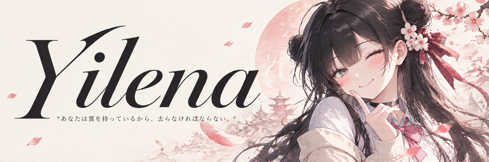
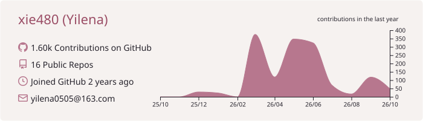
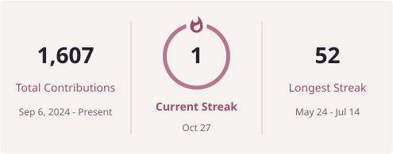
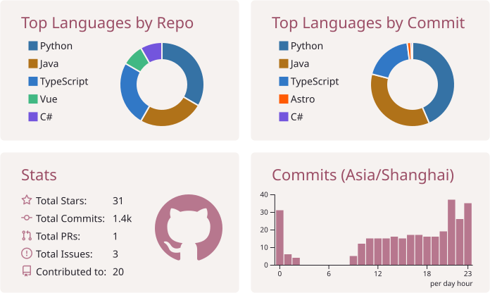
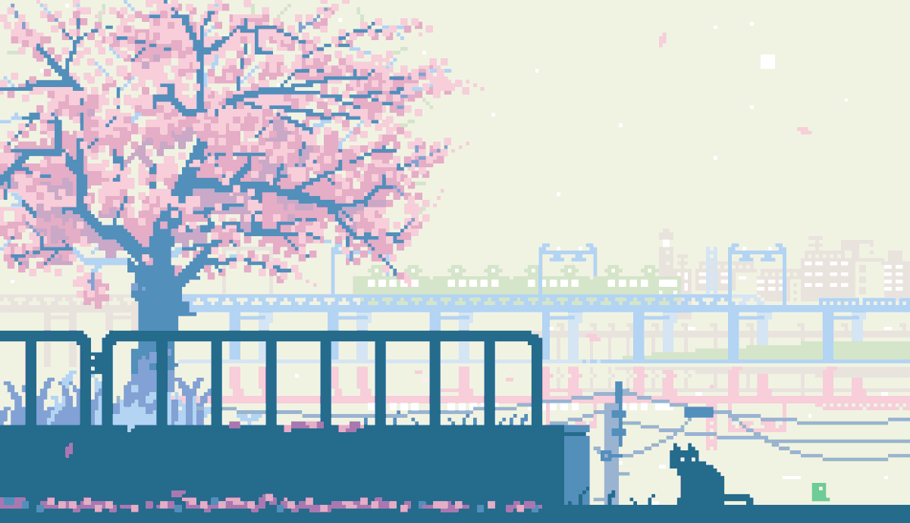

  

  
  &nbsp;
  

 

  

 

<h2 align="center"></h2>

  <picture>
    <source media="(max-width: 600px)" srcset="./assets/stats/profile-mobile.svg" />
    
  </picture>

  

  <picture>
    <source media="(max-width: 600px)" srcset="./assets/stats/grid-mobile.svg" />
    
  </picture>

<!-- METRICS:START -->
<!-- METRICS:END -->

 

<h2 align="center"></h2>

  <picture>
    <source media="(prefers-color-scheme: dark)" srcset="https://raw.githubusercontent.com/xie480/xie480/output/github-snake-dark.svg" />
    <source media="(prefers-color-scheme: light)" srcset="https://raw.githubusercontent.com/xie480/xie480/output/github-snake.svg" />
    
  </picture>

 

  

  

<em>ねこは、ひと休み。 ฅ(=^ω^=)ฅ</em>

